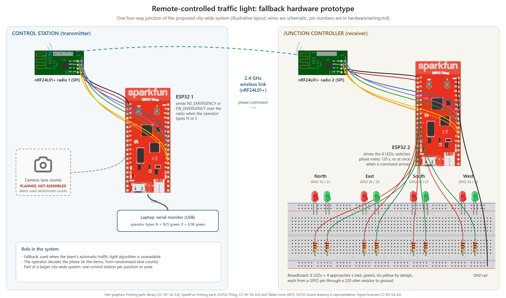
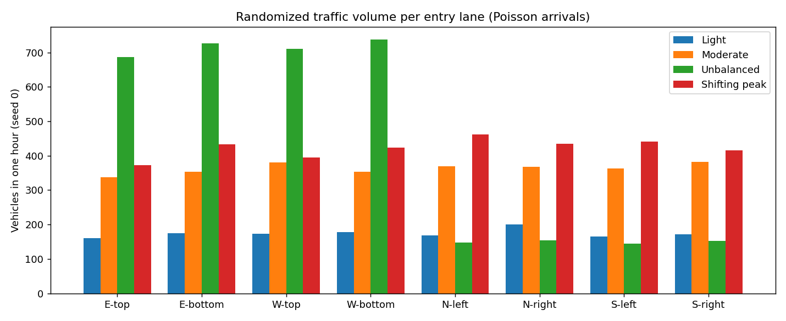
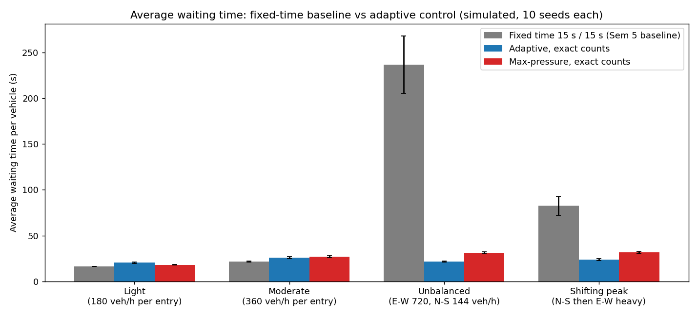
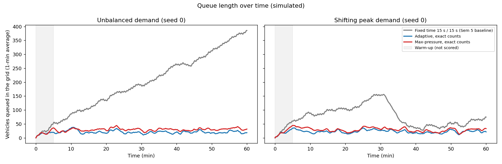
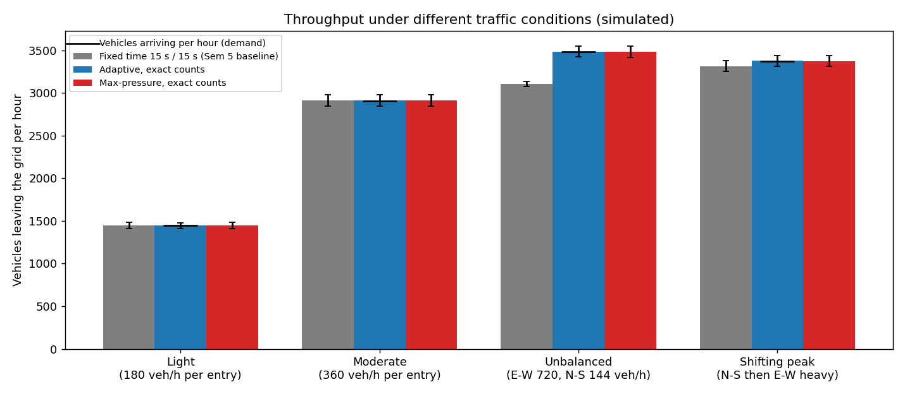
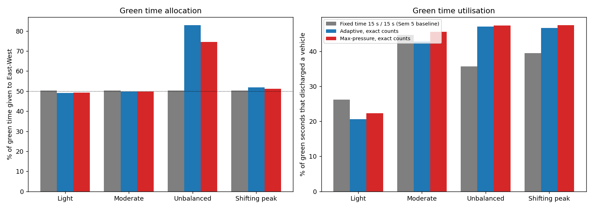
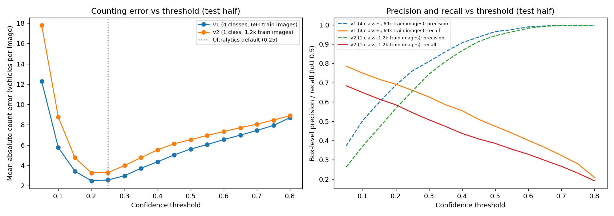
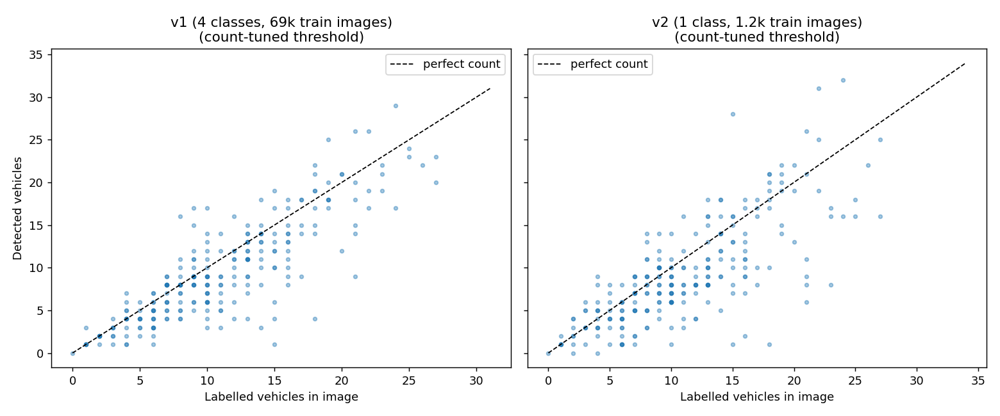
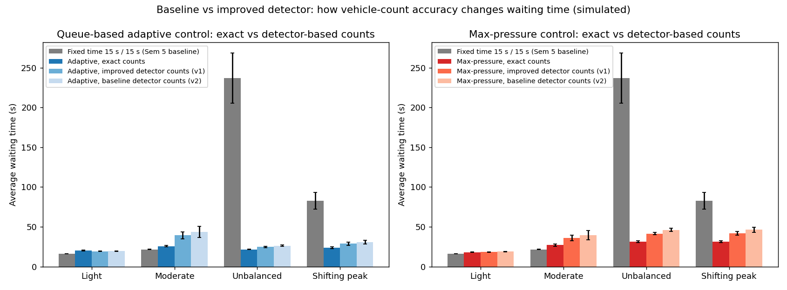

# Smart Traffic Routing System

A traffic-signal system for a city grid. Every four-way junction's signals adapt to the traffic actually waiting, instead of running a fixed timer, and the junctions are meant to work as one city-wide embedded system. This repository holds **my part** of a team project:
- the traffic **simulation**, continued from the previous semester;
- an evaluation of where a **deep-learning vehicle detector** fits in and whether it improves the system;
- the **hardware fallback**: a remote-controlled traffic light for when the team's automatic algorithm is unavailable.



*Hardware layout of the fallback prototype, assembled from Fritzing part graphics (see [ATTRIBUTION.md](ATTRIBUTION.md)). The camera is drawn dashed because it was planned but never assembled.*

## Coursework and team context

**ILGC VI** project course, Semester 6 (Spring 2026), Plaksha University. This continues the team's **ILGC V** project from Semester 5 (Autumn 2025), "Traffic Light Synchronization and Traffic Decongestion System".

This was a team project. The parts in this repository are mine:

| Part | Owner | In this repository |
|---|---|---|
| Traffic simulation: the Webots grid in Semester 5, continued here as a measurable queue model | Me | `simulation/` |
| Vehicle detector (YOLOv8 on BDD100K) and its evaluation for counting | Me | `vision/` |
| Remote-controlled fallback traffic light (hardware and code) | Me | `hardware/` |
| Automatic traffic-light algorithm (single-step look-ahead with a multi-objective cost) | Teammates | Not included. Referred to only as the system the fallback backs up |

## How the system is meant to work

1. Each junction approach has a camera. A vehicle detector counts the cars queued in each lane.
2. The traffic-management logic compares the waiting traffic at every junction and decides which direction gets green and for how long, diverting flow where the network is congested.
3. Each junction controller drives its lights, giving green to one axis (North-South or East-West) while the other is red.
4. If the automatic algorithm fails or is unavailable, an operator controls the junction remotely over a radio link. This is the fallback built here.

What was built and shown: the simulation, the detector (trained and evaluated offline) and the remote-control hardware for **one junction**. The camera was **not** assembled into the hardware, and the demonstration used **randomized lane counts** instead. The city-wide system is the design goal, not something that was deployed.

---

## 1. Simulation (continued from Semester 5)

### Semester 5: Webots

`simulation/webots/` contains the Semester 5 Webots world (`worlds/four_intersections.wbt`) and its supervisor controller (`controllers/supervisor_controller/supervisor_controller.py`):
- a 2 x 2 grid of junctions 50 m apart;
- vehicles spawned round-robin at the eight outer entrances, driving straight through;
- a safe-distance rule so cars don't pile up;
- all four junctions on the same fixed cycle: 15 s green for North-South, 15 s for East-West.

It shows the traffic visually, but it records no measurements, so it could not tell us whether a smarter controller helps.

### Semester 6: measurable queue model

`simulation/grid_sim.py` rebuilds the same grid as a queue model, with the same layout, the same eight entrances and the same 15 s / 15 s baseline. It adds realistic signal details:
- 5 s of lost time whenever the signal changes phase (the clearance a real junction needs for cars already in the box);
- 2 s start-up loss at the beginning of each green;
- one departure every 2 s per lane while green (1,800 vehicles per hour per lane);
- 5 s travel time between junctions.

It records waiting time, queue length, throughput and how green time is used.

Three controllers are compared:

| Controller | Rule |
|---|---|
| Fixed time (Semester 5 baseline) | 15 s green per axis, all four junctions synchronised |
| Queue-based adaptive | After a 5 s minimum green, switch when the other axis has 3 or more vehicles more than the current one waiting. Maximum green 40 s |
| Max-pressure | Same timing limits, but compares *pressure*: vehicles waiting minus vehicles queued at the next junction downstream. This makes a junction take its neighbours into account, the network-level idea behind "monitor the whole city" |

These two adaptive controllers are standard rules I used to measure what vehicle counts are worth. They are **not** the team's automatic algorithm.

**Traffic inputs are randomized.** Arrivals at each entrance are Poisson processes with the rates below. Every controller sees exactly the same arrivals (same random seeds), and each scenario is run with 10 seeds of one simulated hour each (the first 5 minutes are a warm-up and not scored).

| Scenario | Arrival rate per entrance |
|---|---|
| Light | 180 vehicles/h everywhere |
| Moderate | 360 vehicles/h everywhere |
| Unbalanced | East-West 720 vehicles/h, North-South 144 vehicles/h |
| Shifting peak | North-South 648 and East-West 180 vehicles/h for 30 min, then the reverse |



*Randomized number of vehicles entering at each of the eight entrances in one simulated hour (seed 0), per scenario.*

### Results (exact vehicle counts)

| Scenario | Fixed time: avg wait | Adaptive: avg wait | Max-pressure: avg wait | Fixed: throughput | Adaptive: throughput |
|---|---|---|---|---|---|
| Light | **16.3 s** | 20.2 s | 18.0 s | 1,447 veh/h | 1,446 veh/h |
| Moderate | **21.6 s** | 25.8 s | 27.0 s | 2,911 veh/h | 2,912 veh/h |
| Unbalanced | 236.8 s* | **21.7 s** | 31.3 s | 3,104 veh/h | 3,485 veh/h |
| Shifting peak | 82.6 s | **23.8 s** | 31.5 s | 3,315 veh/h | 3,375 veh/h |

(mean over 10 seeds; full table with standard deviations, queue lengths and 95th-percentile waits in `simulation/results/summary.csv`)

\* Under unbalanced demand the fixed cycle cannot keep up: the East-West queues grow for the whole hour, and about 410 vehicles are still in the grid at the end. Their waits are not included in the average, so the true average wait is even worse.



*Average waiting time per vehicle for each controller in each scenario (error bars: ± 1 standard deviation over 10 seeds).*



*Total vehicles queued in the grid over one hour, for unbalanced and shifting-peak demand.*



*Vehicles leaving the grid per hour for each controller; the black line marks the demand (vehicles arriving).*



*Left: share of green time given to East-West. Right: share of green seconds in which a vehicle was actually discharged.*

What the simulation shows:
- **When traffic is uneven or changing, adaptive control is far better.** In the unbalanced scenario it gives East-West 83% of the green time instead of 50%, which keeps the queues bounded and the average wait at about 22 s. The fixed cycle builds an ever-growing queue.
- **When traffic is light and balanced, the fixed cycle is slightly better** (16 s vs 20 s wait). The adaptive rules react to short random imbalances and switch more often, and every switch costs 5 s of clearance time. A practical controller should therefore fall back to a fixed or slowly adapting plan when demand is balanced.
- Throughput is the same for all controllers whenever the fixed cycle has enough capacity. The differences are in waiting time and queue length.
- Max-pressure was slightly worse than the simpler adaptive rule on this small grid. Its advantage, coordinating with downstream junctions, matters more in larger networks with turning traffic, which this model does not include.

---

## 2. Vehicle detector: does deep learning help?

The adaptive controllers need to know how many vehicles are waiting in each lane. In the full design a camera at each junction supplies these counts, and a deep-learning detector turns the images into numbers. I trained YOLOv8n detectors on BDD100K (dash-camera images: 70,000 for training, 10,000 for validation). `vision/train_bdd_yolo.py` is the cleaned training script.

| Run | Classes | Training images | Epochs | Reported by training (its own validation set) |
|---|---|---|---|---|
| v1 | car, bus, truck, motor (4 classes) | 69,271 | 10 | precision 0.60, recall 0.46, mAP50 0.50 (averaged over the 4 classes) |
| v2 | one "vehicle" class | 1,156 | 10 | precision 0.75, recall 0.51, mAP50 0.60 |

At first glance v2 looks better. But the two numbers are not comparable:
- v1's metrics average over four classes, including rare and hard ones (bus, motor);
- v2 was only one class;
- the v2 data preparation stopped after copying 1,156 of the 70,000 training images;
- v2's label conversion used the category names "motorcycle" and "bicycle", which BDD100K calls "motor" and "bike", so motorbikes and bicycles were left out of its labels.

To compare them fairly for the job they actually have, **counting vehicles**, `vision/evaluate_detectors.py` runs both models class-agnostically on the same 493 randomly chosen validation images. It picks each model's confidence threshold on one half of the images and reports results on the other half.

Results on the 247 held-out images (2,700 labelled vehicles, about 11 per image; class-agnostic, IoU 0.5):

| Model | Training images | Confidence threshold | Precision | Recall | F1 | Count error (vehicles per image) | Average bias |
|---|---|---|---|---|---|---|---|
| v2 (1 class) | 1,156 | 0.25 | 0.657 | 0.545 | 0.595 | 3.29 | -1.88 (undercounts) |
| **v1 (4 classes, used class-agnostically)** | 69,271 | 0.25 | **0.761** | **0.660** | **0.707** | **2.56** | -1.46 (undercounts) |

- **v1 is the better vehicle counter.** Once the class labels are ignored, the model trained on the full dataset has 22% lower counting error, higher precision and higher recall than v2. v2's better training numbers came from its easier single-class metric, not from better detection.
- **Threshold tuning did not help.** For both models, the threshold with the lowest counting error on the calibration half was the default 0.25. On the test half, 0.20 would have been marginally better for v1 (2.49), but the threshold was fixed before looking at the test half, so 0.25 is reported.
- Both models undercount on average, by 1.5-1.9 vehicles per image.

So the improvement to the deep-learning part is to **use the v1 model with class-agnostic detection** for counting, not v2.



*Left: average error in the number of vehicles counted per image, against the confidence threshold. Right: box-level precision and recall. Both are measured on the held-out half of the images.*



*Detected vs labelled vehicles per image for each model, at its count-tuned threshold.*

### Effect of count accuracy on the traffic signals

To connect the detector to the signals, the simulation replaces the exact queue counts with what a detector would report. Each waiting vehicle is detected with probability equal to the detector's measured recall, and false detections are added so that the measured precision holds. The two settings compared are:
- **baseline**: v2 at the default 0.25 threshold;
- **improved**: the better model at its count-tuned threshold.

Average waiting time (s) with each kind of count (mean of 10 seeds):

| Scenario | Adaptive, exact | Adaptive, improved (v1) | Adaptive, baseline (v2) | Max-pressure, exact | Max-pressure, improved (v1) | Max-pressure, baseline (v2) |
|---|---|---|---|---|---|---|
| Light | 20.2 | 19.4 | 19.5 | 18.0 | 18.4 | 18.8 |
| Moderate | 25.8 | 39.3 | 43.4 | 27.0 | 35.9 | 39.6 |
| Unbalanced | 21.7 | 24.8 | 26.3 | 31.3 | 41.4 | 46.2 |
| Shifting peak | 23.8 | 28.8 | 30.7 | 31.5 | 41.9 | 46.3 |

- **The better detector gives shorter waits in every busy scenario.** With adaptive control under moderate demand, counting errors add 17.6 s of waiting with the baseline detector but 13.5 s with the improved one. With max-pressure under unbalanced demand, they add 14.9 s and 10.1 s respectively.
- **Counting accuracy matters a lot.** Even with the improved detector, adaptive control under balanced, moderate demand (39 s) is worse than the plain fixed cycle (22 s), because noisy counts trigger unnecessary switches. Under unbalanced or shifting demand, detector-based adaptive control still beats the fixed cycle by a wide margin (25-31 s vs 83-237 s).
- In light traffic, noisy counts slightly *reduce* waiting compared with exact counts. Undercounting makes the controller switch less often, which happens to suit balanced light traffic.
- A deployment should therefore smooth counts over several frames and fall back to a fixed plan when demand is balanced. These are the next steps I would take; they are not implemented here.



*Average waiting time when the controllers use exact counts vs counts from the baseline and improved detector settings.*

Limits of this part:
- BDD100K is dash-camera footage, not a fixed camera looking down a lane, so the counting accuracy at a real junction would differ.
- The detector was evaluated offline and was never connected to the hardware.
- The noise model treats each vehicle independently. Real errors are correlated (occlusion in long queues, night, rain).

---

## 3. Hardware: remote-controlled fallback traffic light

If the team's automatic algorithm fails, the junction must still be controllable. The fallback is a remote control:
- an operator at a control station chooses which direction gets green;
- the command travels over a 2.4 GHz nRF24L01+ radio link to the junction controller;
- the junction controller switches its lights immediately.

| Component | Count | Role |
|---|---|---|
| ESP32 board | 2 | ESP32 1: control station (transmitter). ESP32 2: junction controller (receiver) |
| nRF24L01+ radio | 2 | One per ESP32, on SPI (CE = GPIO 4, CSN = GPIO 5) |
| LEDs | 8 | One red and one green for each of the four approaches |
| 220 ohm resistors, breadboard, jumper wires | | LED wiring |
| Laptop | 1 | Serial monitor used to type the operator's commands into ESP32 1 |
| Camera | 0 (planned) | Lane vehicle counts. **Not assembled**: the demo used randomized counts |

**No yellow light, by design.** Each approach has only red and green, so a change of state is a clean cut from red to green and back. All four approaches switch together: North and South are green while East and West are red, and the other way round. So two crossing directions are never green at the same time.

### Code (`hardware/esp32_prototype/`, Arduino IDE with the RF24 library)

- `Transiver/Transiver.ino` (ESP32 1): reads a key from the serial monitor. `N` sends `NS_EMERGENCY` (North-South green) and `E` sends `EW_EMERGENCY` (East-West green), as a 32-byte message on pipe address `00001`.
- `Reciver/Reciver.ino` (ESP32 2): starts with North-South green and listens on the same address.
  - When a command arrives, it switches to that phase at once and restarts its timer.
  - With no commands, it alternates the two phases every 120 s on its own.
  - Messages it doesn't recognise are ignored, and the lights keep their current state.

Pin assignments are in `hardware/wiring.md`. The code is kept exactly as it was used in the demonstration.

Limitations: this is an educational prototype. There is no clearance interval between phases, no acknowledgement or heartbeat on the radio link, and none of the hardware safety interlocks real traffic controllers have (conflict monitor, watchdog relay, battery backup).

---

## Repository layout

```
simulation/
  webots/                 Semester 5 Webots world and supervisor controller
  grid_sim.py             queue model of the same grid
  run_experiments.py      runs every scenario and controller, writes results/ and the graphs
  results/                summary.csv, per_run.csv
vision/
  train_bdd_yolo.py       BDD100K -> YOLO conversion and training
  evaluate_detectors.py   class-agnostic comparison and count-threshold tuning
  weights/                trained YOLOv8n weights (v1, v2)
  training_runs/          training logs and curves from both runs
  results/                detector_comparison.csv, count_pairs.csv
hardware/
  esp32_prototype/        transmitter and receiver sketches (ESP32 + nRF24L01+)
  visualization/          builds assets/images/hardware_layout.png from the part graphics
  wiring.md
assets/graphs/            all result graphs
assets/images/            hardware layout figure
```

## How to run

```
pip install -r requirements.txt
cd simulation && python run_experiments.py                 # about 2 minutes
cd vision && python evaluate_detectors.py --data <folder with images/val and labels/val>
```

The Webots world opens in Webots R2025a. For the hardware, install the RF24 library in the Arduino IDE, wire as in `hardware/wiring.md`, flash `Transiver.ino` to one ESP32 and `Reciver.ino` to the other, and open the transmitter's serial monitor at 115200 baud.

## Data and licenses

BDD100K images are not included (see the BDD100K license). The hardware figure uses Fritzing part graphics (CC-BY-SA 3.0), the SparkFun ESP32 Thing part (CC-BY-SA 4.0) and a Tabler Icons camera (MIT), listed in [ATTRIBUTION.md](ATTRIBUTION.md).
